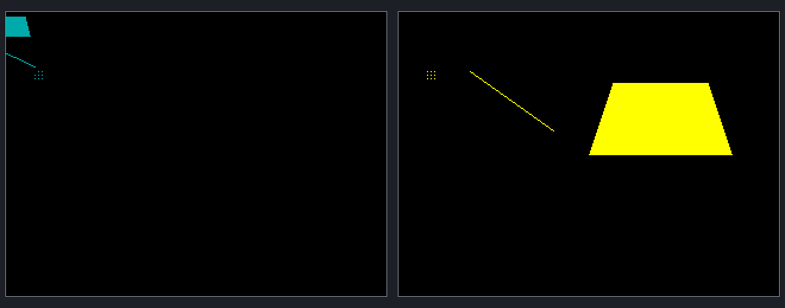

# GOLEM-018 — First resident geometry and pixel demo

Point, line and filled convex-quad jobs are implemented and callable by name from
assembly. Compiler/sanitizer, real assembler and stock Pi/Oryx headless checks
pass, including 5,704 resident/direct pixel comparisons. The dedicated Oryx demo
is staged. The Author confirmed dir worked, and retrieved results match all checks.
The Author confirmed the reference matches the display. GOLEM-018 passes human
visual and keyboard review; the Author explicitly approved commit and push.

## Run on Oryx

```bash
cd ~/Agon/mystuff/golem/.emulator
rm -f sdcard/golem-018/results.dat
SDL_VIDEODRIVER=x11 ./fab-agon-emulator --renderer sw
```

Allow about 10 seconds for the diagnostic drawings to finish. The final display
shows a small group of dots on the left, a diagonal line in the middle and a
filled trapezoid on the right. Follow the onscreen instruction to type dir at
the MOS prompt, close the emulator and tell the agent whether it worked. The
agent retrieves and verifies saved observations afterward. No second terminal
or verifier command is needed. The launch block removes old results, so it is
safe to rerun after closing the emulator.

The numerical verifier reports 11,451 checks and 12,589 bytes. A successful
numerical run does not replace the Author's visual and keyboard review.

## What the drawings should look like



Left is the temporary cyan clipping case. Its quad begins at negative X and
is cut off at the upper-left screen edge; its line also begins off-screen. The
remaining cyan dots retain their fixed positions. This is intentional test
input, not a placement error. Cyan also appears in the preceding partial-update
case at the usual larger geometry positions. Right is the final restored yellow
group of nine dots, diagonal line and filled trapezoid.

This is a layout reference generated from fixture coordinates, not an emulator
screenshot. Text is omitted; polygon boundary pixels can differ from stock
triangle rasterization. [make_reference.py](make_reference.py) regenerates it
using the project-local Python without extra dependencies.

## Implemented interface

[geometry.golem](geometry.golem) declares every input and initializer, then draws
nine points, a line and a convex quad in one finite Sub drawGeometry. Compile
with --resident --emit-asm and call golem_drawGeometry from assembly. The
[maintained contract](../../design/resident-drawing.md) documents grammar, typed
arguments, packed offsets, graphics-state assumptions and ownership. The whole
examples.golem file remains a collection of independent examples, not one program.

The demo installs 775 bytes in 13 owned buffers. Its packed input block is
29 bytes, whole-block update plus call 46, unchanged call six and cleanup 78.
Assembly owns loading, graphics setup, updates, invocation and pacing. No custom
VDP command, runtime copy readback, acknowledgement or new error protocol is added.
The production path simply patches private templates and executes them.

## Evidence

| Qualification | Result |
| --- | --- |
| Maintained compiler checks | Pass, 92 rejection cases across all profiles |
| Address/undefined-behavior sanitizers | Pass |
| Prior scalar/table packages | 12 configurations preserve all six artifacts against 29e269e |
| Real ez80asm consumers | Default, relocated and near-ID-limit layouts pass, including packed byte/word offsets and actual wrapper instructions |
| Failure before publication | Six CLI/source/export failures preserve all six output files |
| Stock Pi Fab 1.2.5 / MOS 3.0.2 | 11,451 checks, 5,704 direct/resident pixel pairs, 12,589 saved bytes |
| Dedicated Oryx stock runtime | Identical saved bytes; headless pass; emulator stopped |
| Human MOS keyboard review | Author confirmed dir worked |
| Saved human-run results | Retrieved and verified: all 12,589 bytes match |
| Human visual review | Passed; Author confirmed the supplied reference matches what they saw |

The stock fixture executes the compiler-generated assembly wrapper for the
default package; relocated IDs exercise the same generated invocation packet.
It compares point clusters, lines and convex quads to independently spelled
direct stock commands. The direct quad explicitly sets each triangle rather
than reproducing the compiler's perimeter permutation. Known interior/exterior
samples additionally check the expected colour and catch a missing quad corner.
Signed clipping, unchanged repeated calls, partial byte/word updates, persistent
packed inputs, immutable entry bytes, cleanup/reinstall and reserved buffers are
covered. Stock pixel queries wait for drawing completion in the test fixture;
this does not add a fence or observation traffic to production calls.

The first successful Pi run took 6.323 seconds. After simplifying onscreen
instructions, the final fixture took 6.419 seconds. Host checks, sanitizer build,
baseline build and assembler consumers together took 52.598 seconds. Oryx's
local duration is recorded in [oryx-review.json](oryx-review.json). Times are local
monotonic measurements, not calibrated hardware or cross-host performance claims.

[host-checks.json](host-checks.json), [emulator-checks.json](emulator-checks.json)
and [oryx-review.json](oryx-review.json) record source/runtime hashes and results.
[human-review.json](human-review.json) records the retrieved human-run results,
verified staging identity, keyboard confirmation and visual-review status.
The first stock run verifies fixed buffer observations, known pixel colours and
direct/resident equality before freezing expected.dat for subsequent human review.

Reproduce automated checks with the project-local Python:

```bash
.venv/bin/python docs/tasks/GOLEM-018/run_checks.py
.venv/bin/python docs/tasks/GOLEM-018/qualify.py
.venv/bin/python docs/tasks/GOLEM-018/prepare_oryx.py
```

All emulator launches by these scripts are headless. Oryx preparation preserves
the accepted dedicated runtime, backs up previous startup under ignored build/,
verifies the staged binary/results, removes headless output and leaves the
emulator stopped for fresh human review. General plot, bitmaps/transforms and
viewport/scroll support are later implementation work.
