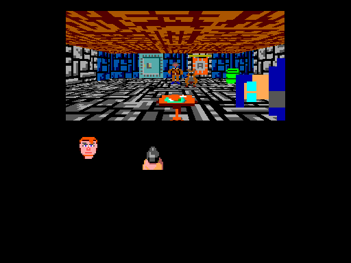
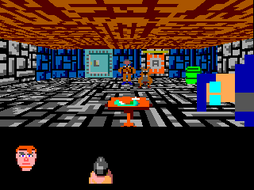

# Wolf bitmap review assets

The corrected static visual review passed, and its saved run matches all 864
checks. The later GOLEM-020 animation/MOS review also passed; the Author explicitly
approved commit and push. The emulator is stopped. All four familiar
AgonWolf3D images appear at native size, centred on a 512×384 display with a
separate instruction/MOS text area below them. Stock local/Oryx headless checks
pass; launch it using the commands below.

## Oryx visual review

Run in your Oryx terminal:

```bash
cd ~/Agon/mystuff/golem/.emulator
rm -f sdcard/golem-019/results.dat
SDL_VIDEODRIVER=x11 ./fab-agon-emulator --renderer sw
```

This launch displays one scene. All four bitmap draws come from
[review.golem](review.golem), called once through the generated assembly wrapper.
The screen labels that explicitly: `GOLEM: review.golem (four draw_bitmap calls)`.
Assembly loads assets, sets up the display, installs/calls Golem and prints text.
No direct bitmap comparisons or intermediate diagnostic scenes run in this demo.

The splash is 320×160 at (96,16); BJ is 32×32 at (112,200), the pistol frame
64×64 at (192,184) and the small icon 40×20 at (296,206). No scaling is applied.
This reference omits the onscreen text:



Follow the onscreen instruction to type `dir` at the MOS prompt. Then close the
emulator and tell the agent whether the images look right and `dir` worked.
The agent retrieves/verifies the saved results; no second terminal or verifier
command is needed. The same launch commands safely rerun the test.

## Original asset layout

The initial example draws the same assets on a black 320×240 display.
This reference decodes the actual RGBA2222 payloads,
including transparency; it does not invent, resize or redraw the artwork.



| Image | Native size | Position (x,y) | Wolf buffer ID |
| --- | --- | --- | --- |
| Splash | 320×160 | (0,0) | 8202 / 0x200A |
| BJ face, full health | 32×32 | (16,184) | 8195 / 0x2003 |
| Pistol, first frame | 64×64 | (96,168) | 8463 / 0x210F |
| Pistol inventory icon | 40×20 | (200,190) | 8201 / 0x2009 |

The splash fills the upper 160 rows. Below it, BJ is on the left, the pistol
frame is in the middle and the small inventory icon is on the right. The sprite
rectangles retain their transparent margins; the visible artwork can occupy
less than the stated dimensions. The purple mask visible in some source PNGs
becomes transparent in Wolf's existing RGBA2 payloads.

`assets/wolf-review.agnb` contains only these four existing LIST BUFR records,
copied byte-for-byte from AgonWolf3D's `tgt/ui.agnb`, with their original embedded
buffer IDs. The accompanying `.rgba2` files are unchanged payloads. Source paths,
dimensions, placement and hashes are in [assets.json](assets.json).
The source Wolf checkout is read-only and was not modified.

Recreate this selection from the neighboring Wolf checkout:

```bash
cd ~/Agon/mystuff/golem
.venv/bin/python docs/tasks/GOLEM-019/prepare_assets.py
```

The script compares each payload and dimension with Wolf's existing container,
then re-reads the subset with Wolf's validator. The compiler now implements
plain bitmap drawing; stock headless bitmap qualification passes. Oryx human
static review passed; its separate keyboard check is superseded by successful
GOLEM-020 animation/MOS review.
Assembly will load the AGNB once and Golem will refer to buffer IDs. Repeated
drawing must reuse these installed assets rather than resend their pixels.

## Compiler and assembly interface

[bitmaps.golem](bitmaps.golem) draws the four images in the reference layout.
Compile it with:

```bash
make -C src all
build/golemc --resident --emit-asm \
  --reserve 8195:8195 --reserve 8201:8202 --reserve 8463:8463 \
  docs/tasks/GOLEM-019/bitmaps.golem docs/tasks/GOLEM-019/build/wolf
```

The assembly application loads/registers `assets/wolf-review.agnb`, sends
`golem_package_bootstrap` once, and calls `golem_drawWolf` whenever needed.
Generated field symbols publish the input locations: bitmapBuffer is a uint16
at offset 0, x/y are sint16 at offsets 2/4. Only compiler-owned buffers are
installed or cleaned up. Literal and initial asset IDs must be reserved;
subsequent host changes must select a reserved, loaded bitmap. No filename
lookup or per-draw payload upload is introduced.

This package installs 262 bytes into six owned buffers. Repeating the complete
four-image drawing costs six wire bytes; updating all six input bytes and
calling costs 23. The one-time asset/container transfer is separate.

Run the focused host qualification with:

```bash
.venv/bin/python docs/tasks/GOLEM-019/check_bitmap.py
```

The host checks cover grammar/types, full-ID templates, ownership, exact prior
geometry artifacts, prior CLI profile selection, sanitizers and real ez80asm
consumers. See [bitmap-host-checks.json](bitmap-host-checks.json) for evidence.

## Automated stock qualification (separate from the human demo)

CHK-001 passes in the project's existing stock Fab 1.2.5/MOS 3.0.2 profile:
18,526 checks, 18,476 pixel observations, 5,152 direct/resident pixel pairs and
18,869 saved bytes. Final local headless execution took 7.299 seconds, including
the centred review picture. Earlier qualification runs took 17.976 and 11.817
seconds. These are execution durations, not drawing benchmarks.

- PIX-001: The actual assembly guest loads the four records once through the
  canonical AGNB API. No asset payload is embedded in Golem's bootstrap/tape.
- PIX-002: Default and relocated packages use the real generated wrapper or
  entry packet. Initial calls repeat without uploads; ID-only and position-only
  updates preserve the other packed inputs, including a change of the ID's high
  byte. Reinstall restores declared input values.
- PIX-003: Independently composed RGBA2 reference pixels check native placement,
  binary transparency over black and grey, signed negative clipping, image
  borders, gaps and each represented output colour. Three cases also compare
  independent direct stock bitmap commands with the resident drawing.
- PIX-004: A stock affine translation is first proved active with a translated
  BJ pixel. Golem's following call produces the untransformed native layout.
  Bootstrap also works when stock affine support starts disabled.
- PIX-005: After cleanup, compiler buffers are absent, external canaries and
  image prefix/suffix bytes remain intact, and all four registered images still
  draw correctly. These are bounded fixture observations; no copy verification
  or completion fence is added to the production drawing job.

The fixture assigns an identity logical palette so returned pixel indices match
physical RGB222. This preserves the bitmap RGB appearance while making the
expected pixel values independent of the default logical colour numbering.
The stock read-pixel query waits for queued drawing; it is test instrumentation.
The canonical loader snapshot and its provenance are retained in this silo.
Local assembly dependencies use exact word accesses; the edited guest/support
width audit reports no hazards. The 132,210-byte guest fits the physical 256 KiB
user RAM window.

Reproduce the automated headless qualification on this development host:

```bash
.venv/bin/python docs/tasks/GOLEM-019/qualify.py
```

This uses the generated profile-local launcher with dummy SDL video/audio,
verifies the mapped stock VDP/runtime and restores the previous autoexec before
returning. [emulator-checks.json](emulator-checks.json) records runtime/fixture
hashes and results. The frozen [expected.dat](expected.dat) was saved only after
all model, direct-comparison and buffer observations passed.

The human demo uses demo_guest.asm and the unchanged AGNB in Oryx's dedicated
profile. prepare_demo.py builds and checks this single-call presentation against
864 expected Wolf pixels; it contains no direct bitmap draws or diagnostic
scenes. demo-checks.json/demo-expected.dat describe this short demo, while
emulator-checks.json/expected.dat retain the separate 18,526-check automated run.
[oryx-review.json](oryx-review.json) records the matching runtime/fixture hashes
and successful remote headless run. Its old autoexec is backed up; the new
startup runs this test. Headless results were removed and the emulator is stopped
so the human review produces fresh observations. [review.golem](review.golem)
is the final centred drawing; a lower text viewport keeps instructions and MOS
directory output from scrolling the artwork. The Author confirmed the earlier
combined run's pictures looked fine; its retrieved 18,526 checks/18,869 bytes
matched. That confusing presentation is superseded by the labelled single-scene
demo, whose static picture and 864 saved bytes subsequently passed review.

The short review.golem file is the complete Golem drawing routine. Extra scenes
in the former combined review came from qualify.py/guest.asm's automated test
tape: parameter changes and independent direct stock commands. Those remain in
the automated qualification, and are excluded from the current human demo.
