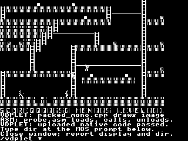
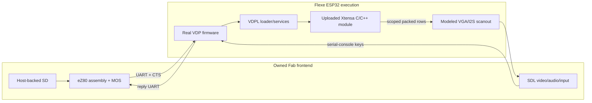

# Fab/Flexe emulator and native vdplets

The hardware runtime and SDK now live in the separate
[agon-vdplet repository](../../../../agon-vdplet/README.md), with its own
[hardware usage guide](../../../../agon-vdplet/docs/STARTHERE.md).
This task retains the emulator integration and historical qualification evidence.

The new emulator works on Pi and Oryx: Fab supplies eZ80/MOS, SD and SDL, while
Flexe executes actual ESP32 firmware and runtime-uploaded Xtensa modules. Both
engines pass the complete native numeric/renderer proof. Oryx is staged and
stopped for human review. The agon-6502 owner accepted the service ABI; its
separately supplied F2/F3 codec now passes actual uploaded-Xtensa qualification
in both engines. Golem also supports multiple named drawing Subs sharing
resident globals. Nothing has been flashed, committed or pushed.

## Human review on Oryx

```bash
cd ~/Agon/mystuff/golem/docs/tasks/GOLEM-021/.emulator
./fab-agon-emulator
```

After startup and the finite tests, the display shows a real Lode Runner image.
The uploaded `packed_mono.cpp` module draws it; `probe.asm` loads, invokes and
unloads the module. Those roles and the keyboard-review instruction appear
below the image. Follow the on-screen instruction, close the emulator and
report whether the image and MOS command worked. The agent retrieves results;
there is no second terminal or verifier command. Rerunning the same launcher
removes stale saved results first.



## What executes where



The native module is separately compiled, uploaded after boot and executed at
an allocated ESP32 IRAM address. It is not linked into the firmware or replaced
with a host implementation. Loading the diagnostic ELF does not activate
Flexe's firmware compatibility hooks. Firmware and normal FreeRTOS execution
remain in the emulated ESP32.

The one-time loader/service addition requires a vdplet-enabled firmware build.
Subsequent module changes need no firmware rebuild. Private experimental D8/D9
selectors provide discovery/load/run/unload; ordinary stock buffer commands
carry package/data bytes and can hold a preinstalled call packet.

## Fresh qualification

| Check | Result |
| --- | --- |
| Stock VDP and MOS/BASIC | Both engines: boot, filesystem, commands, arithmetic, loops and serial-console keys. |
| Video/audio | Both native Oryx engines: nine advertised geometries with exact glyph pixels; exact 1,024 Hz audio. |
| Executable replacement | 14 core coherence cases, plus real postboot load/reload and changed instructions at the same IRAM address. |
| Final full MOS fixture | Both Oryx engines: 56 replies / 560 saved bytes and actual post-success MOS prompt. |
| Native renderer | 61,440 decoded VGA pixel checks per run: 280x192 Lode Runner plus unchanged black margin. |
| agon-6502 native codec | 36 Oryx runs: 32,708 checked replies, 2,211,840 image/margin pixels and eight complete 7,680-byte retained observations. |
| Failed native calls | Unsupported mode, short inverted source and negative geometry reject; final pixels remain correct. |
| Runtime errors | No failed backend, unhandled peripheral, unregistered ROM call or unmapped memory access in final runs. |

Receipts and their exact artifact identities are in
[`evidence/oryx-packed-jit.json`](evidence/oryx-packed-jit.json) and
[`evidence/oryx-packed-interp.json`](evidence/oryx-packed-interp.json).
INFO17 records live command-task stack margin; that allowed diagnostic can vary
between runs. Host execution durations are useful test estimates, not physical
ESP32 performance measurements.

The renderer package is 1,392 bytes: 572 executable bytes and four data bytes,
with one relative relocation and a 144-byte compiler stack frame. The two numeric
packages additionally exercise persistent BSS and four relative fixups.
The packed firmware binary is 1,086,192 bytes, with 45,032 bytes static DRAM.
Exact hashes and supported ELF/ABI limits are recorded in
[`GOLEM-002/runtime/qualification.md`](../GOLEM-002/runtime/qualification.md).

## Wire traffic

A direct silent RUN frame is 17 bytes. Assembly can install it into a stock
buffer once and invoke the resident packet with six wire bytes. The review does
that twice. Module/data installation, changing arguments, diagnostic replies and
test-only result reads are counted separately.

The main review's packed module consumes already decoded pixels. The separately
qualified agon-6502 module performs native F2/F3 XOR decoding and packed-row
rendering using the same generic services. Its [report and source identities](codec/README.md)
keep that owner's code separate. These functional proofs do not measure a running
game's speed or compression ratio.

## Reproduction and source boundaries

Start with [`emulator/README.md`](emulator/README.md) for owned-source export,
build, Oryx source bundle and native adapter details. Then follow
[`consumer/README.md`](consumer/README.md) for firmware/module fixtures, canonical
profile generation, headless qualification and Oryx deployment. Read the module
API in [`vdplet.h`](../GOLEM-002/runtime/vdplet.h) and the actual row-copy source in
[`packed_mono.cpp`](../GOLEM-002/packed-mono/packed_mono.cpp).

| Component | Pinned source |
| --- | --- |
| Fab Agon Emulator 1.2.5 | `c22876d1f7ad903537c308cf65afd6553b37cdb8` |
| Flexe | `fbda8e905ccff36a090e4e33b0ffc2337dd79c52` |
| Physical VDP firmware base | `1056ee38ec1cc68ed327bd32ee47d04b1c30597c` |
| VDP graphics library | `ac2dd5986daf496c43ae8e7fe41836274aec54a0` |
| MOS | Tagged 3.0.2 Arthur, binary/map hashes enforced by the launcher. |

Upstream source trees remain unchanged. Small owned patches correct Linux ARM64
JIT cache maintenance, executable-RAM invalidation, UART RX idle timeout and the
Fab native frame-counter/cleanup interface. Build products and source exports
remain ignored task artifacts. Existing accepted Golem emulator profiles are
preserved.

## Limits and follow-through

Keyboard input uses the firmware serial console; Flexe does not emulate the
physical PS/2 ULP path. Mouse/raw-keyboard fidelity and custom VGA timings remain
limited. Cross-CPU timing is functional, with possible frame coalescing. Trusted
native modules must return; they are not isolated from firmware faults.

Physical acceptance, flashing and human graphical/keyboard acceptance are not
claimed. Emulator-related changes remain uncommitted until the Author tests
the resulting behavior and explicitly approves committing them.

The service offer and codec coordination use the canonical mailbox thread
`agon6502-golem-vdplets`; the codec owner confirmed the current callbacks suffice.
Its source stays in agon-6502, and Golem owns hybrid qualification. The remaining
window also funded the bounded [GOLEM-022](../GOLEM-022.md) compiler tranche:
multiple finite named drawing Subs share persistent globals, with assembly
selecting a six-byte call. Host/sanitizer and real assembler checks pass; all
120 legacy package files remain byte-identical. Focused stock Oryx default and
relocated packages each pass 370 checks/415 bytes. Its separate recognizable
Wolf [source and stopped review instance](../GOLEM-022/qualification/README.md)
are ready for the Author after the main hybrid review.
