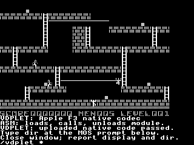

# Uploaded agon-6502 F2/F3 codec qualification

The codec owner's unchanged C++ module passes actual uploaded-Xtensa execution
on Oryx in both Flexe engines. Thirty-six fresh MOS runs match 32,708 replies,
2,211,840 physical-VGA image/margin pixels and eight complete retained-buffer
observations. The existing generic loader firmware needed no rebuild or
codec-specific host hook. The agon-6502 owner accepted this functional execution proof; its source and
physical deployment remain under that owner's control. Human review and physical
acceptance remain separate.

## Delivered module and actual execution

The owner supplied `apple-codecs.vdpl`, SHA-256
`fd1aa6a5d1c4d51f0f27fd191de896cee4c7e93480f8a611e6e96ac798fd6092`.
It is 2,288 bytes, with 1,280 executable bytes, 132 data bytes, two relative
relocations, no undefined imports and one static 192-byte compiler stack frame.
The matching public ABI header has SHA-256
`2311c7abb3a0470e293ad6c30ef7aefe9aff6375cccc90c181be64c0045a549d`.
Original source remains at
`/Agon/mystuff/agon-6502/experiments/perf020/vdplet/codec.cpp`.
The read-only received package, source and fixtures are preserved under
`build/supplied/`; `build/source-pins.json` records every copied hash.

Entries 2 and 3 implement Apple-native F2 literal runs and F3 single 7-bit
literal XOR respectively. Both consume fourteen argument bytes: seven
little-endian 16-bit fields for target ID, source ID, explicit encoded length,
signed x/y, width and height. The module validates the whole encoded prefix and
obtains a preflighted frame lease before mutating retained bytes. It performs
the XOR and Apple-to-MSB packed row conversion itself, through actual Xtensa
instructions. The generic firmware services supply scoped buffers and rows.

Every run uploads after real MOS/VDP boot, obtains a fresh handle, executes at
observed IRAM entry `0x40097f6c`, unloads and returns to the MOS prompt. No failed
backend, unresolved peripheral, unregistered ROM call or unmapped access occurs.
INFO17 reports at least 2,196 bytes of minimum free command-task stack across
these runs. This measures the executed firmware callback chain; the compiler's
192-byte figure covers only module code and is not a stack enforcement mechanism.

## What passed

Each codec's eight-step sequence was run as eight independent prefixes, so
every intermediate image received its own decoded physical-VGA capture. Each
prefix was run with JIT and interpreter. Separate mode-8 rejection cases bring
the total to thirty-six runs.

1. Explicit valid prefixes ignore sixteen stale source-tail bytes.
2. Overflow after a valid prefix, incomplete coverage and out-of-bounds geometry
   reject with the specified status while retaining the prior image.
3. Repeating the same XOR restores black while preserving Apple phase bits.
4. Zero-length redraw works with the named source missing, both for black and
   the retained Lode Runner image.
5. Unsupported mode rejects before retained mutation; the initially black
   mode-8 image/margin remains black.

Each call observes twenty selected retained bytes. Final-prefix and unsupported
cases additionally read all 7,680 retained bytes: eight complete observations
across both engines, totaling 61,440 bytes. The offline verifier reconstructs
those bytes from actual reply payloads and computes their measured SHA-256.
Intermediate `retained_sha256` fields in runtime receipts describe **expected**
state; they do not claim whole-buffer observation. The explicit
`observed_retained_sha256` fields in
[independent-verification.json](evidence/independent-verification.json) exist only
for complete reads.

The VGA oracle checks all 320x192 pixels: the 280x192 image and its forty-pixel
black right margin. It excludes the text footer. Independent bit-by-bit packing
uses Apple bit zero as the leftmost dot rather than copying the module's
reversal lookup table. This is the actual captured F3 output:



The assembly runner supplies only transport, correlations and diagnostic
observations. It does not decode or draw the image. All readback belongs to
qualification, outside the normal call. Normal dispatch can still use a
preinstalled silent RUN packet and a six-byte buffered call; changing encoded
data/arguments remains additional wire traffic.

## Evidence and reproduction

[summary.json](evidence/summary.json) records exact per-run counts, durations,
runtime identities and preservation of the main human-review profile. Raw
transcripts, expected replies, backend statistics and physical VGA frames are
named `<f2|f3>-<step01..08|mode8>-<jit|interp>` under `evidence/`. The retrieved
archive and every member were hash-checked. Native Oryx frontend, adapter and
firmware hashes match the delivered main integration proof.

From the Golem root, with the owner's pinned input package present:

```bash
.venv/bin/python docs/tasks/GOLEM-021/codec/build.py
.venv/bin/python docs/tasks/GOLEM-021/codec/stage_oryx.py --bundle-only
.venv/bin/python docs/tasks/GOLEM-021/codec/stage_oryx.py
.venv/bin/python docs/tasks/GOLEM-021/codec/verify_saved.py
```

Staging reuses the native Oryx runtime and exact canonical profile-generator
snapshot. It operates only on `codec/.emulator`, verifies the main profile's
hashes afterward and leaves a representative F3 scene staged/stopped. The
task-local MOS runner uses ordinary RAM: probe ends at `0x04a068`, below its
`0x050000` tape; largest tape is 137,318 bytes within 192 KiB; largest transcript
is 39,380 bytes within 40,000. The original main proof runner retains its smaller
limits.

The thirty-six executions total 348.130 seconds on Oryx, ranging from 8.491 to
13.107 seconds. Those durations include boot, SD reads, upload and diagnostic
readback; setup/retrieval are additional. They are reusable test estimates,
not ESP32/game performance or compression claims. No physical target was touched.

The service/result handoff is immutable mailbox message
`2026-10-12_11-32-44_golem_vdplet-codec-qualified-four`; its receipt is
[service-result.json](evidence/service-result.json).

Owner acceptance is message `2026-10-12_11-33-37_agon-6502_perf020-codec-proof-accepted-fourteen`. It confirms no required fixes while keeping physical/game acceptance separate.
