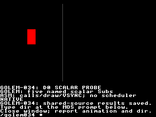

# GOLEM-034 — Pinned compiler and shared root interface

D0 is implemented and automatically qualified. It exports the committed float
compiler at **25901e5**, adds the peer-accepted root interface, and supplies
immutable default/relocated buffered and native packages. Rally has the delivery
for its independently owned adapter. The Author accepted Oryx visual/keyboard review; retrieved results match all
1,115 observations/11,069 bytes. The Author explicitly approved commit/push and proceeding to GOLEM-035.

## Review

Read [the complete Golem program](probe.golem). Golem calculates movement,
reflections, colour and the pause/reset state. Assembly invokes entries, copies
the computed drawing fields into VDU commands and paces with VSYNC. Both
backends share the same state continuously; the caption changes every 12 frames.
The square moves green to the right and red to the left, pauses for 60 frames,
resets near the centre, then later restarts from the left. It finishes red at
x56..72, beside the gray x128 marker.

On Oryx, run in one terminal:

```bash
cd ~/Agon/mystuff/golem/docs/tasks/GOLEM-034/.emulator
./fab-agon-emulator
```

Watch the animation. Follow its onscreen instruction to type `dir` at the MOS
prompt, close the emulator, and report whether both worked. The agent retrieves
and verifies the saved results; no verifier command or second terminal is needed.
The launcher removes previous result/failure files, so repeating the test is safe.

This is a **scalar interface probe**, not Rally gameplay. Tick120 and Render30 are
logical entry names. Assembly invokes both synchronously each frame; no 120/30 Hz
scheduler, input synchronization, opponent simulation or collision transport is
implemented. The stock/native distinction is a caption, not a different program.



## Delivery and interface

1. [Delivery pointer](delivery.json) identifies the immutable bundle and its
   SHA256. The bundle contains `bundle.json`, both package directories, frozen
   source and qualification receipts. Its file map hashes every included file.
2. Each `delivery-manifest.json` contains `interface`, `root`, `backends`,
   `native_module`, `resources`, input identities and artifact hashes. Resolve
   delivered artifact filenames from that map; absolute SDK build paths record
   provenance rather than deployment destinations.
3. [Accepted root contract](root-contract.md) defines widths, ownership and
   failure behavior. `root.json.fields` maps names to offsets; `interface.json`
   adds typed source fields and generated logical entry IDs. `state.bin` is the
   complete explicitly installed initial root. This fixture is 126 bytes: a
   112-byte header and 14 source bytes.
4. `layout.inc` exports root/source offsets and logical entry IDs. `calls.inc`
   exports `golem_buffered_<Sub>` and `golem_native_<Sub>` for all five named Subs.
   Each assembly wrapper sends six wire bytes. `backends.json` identifies shared
   state, private ownership, install/cleanup artifacts, native argument buffer,
   generic buffered dispatcher and fresh native handle patch offset (currently 24).
5. Descriptor bindings are fixed build-time inputs in [bindings.json](bindings.json).
   This fixture uses four zero-filled placeholder buffers solely for admission
   and lifetime checks. Assembly installs and retains those exact declared ranges.
   Native checks actual root length and bound ranges through SDK leases. Stock
   cannot inspect physical lengths and depends on assembly's installed invariant.
6. `interface_status`, `language_status`, host-owned `runtime_result` and
   last-success generation/entry/session are separate channels. Generation counts
   successful invocations across all entries modulo 2^32, not simulation ticks.
   Source failure retains prior effects and never publishes new success markers.
   No invocation automatically updates the host-owned runtime result field.

The baseline [receipt](baseline-receipt.json) pins all six exact committed source
files, SDK source/header/build tools and the build-host image validator. The frozen
closure is under `baseline/`; [root.hpp](root.hpp) and [compiler.cpp](compiler.cpp)
are an explicit D0 extension, not changes to the historical compiler or production
src. The accepted root proposal and later committed-float correction have peer
receipts. SDK/runtime source and firmware are unchanged by D0.

The immutable source export preserves `source/docs/tasks/GOLEM-034/`. To rebuild,
copy that source tree to a working directory, select this project's Python venv,
and set `GOLEM_VDPLET_SDK` to the pinned SDK checkout. Run its
`build_delivery.py probe.golem OUTPUT/probe` with the source's actual path;
the script builds the C++ compiler, verifies frozen inputs and packages native C.
`--prefix 254` produces the relocated variant. The pinned native toolchain is
ESP32 GCC 8.4.0/esp-2021r2-patch5. Host executable hashes are build-machine receipts;
a different host architecture needs its own image-validator build/receipt.
Do not write build outputs into the immutable delivery folder.

## Qualification

1. [Host checks](host-checks.json): 2,270 model/generated-C cases across default
   and relocated packages, ASan/UBSan, seven binding-CLI rejections, bounded lease
   cleanup and retained-root/private ownership checks. Maintained compiler checks
   also pass, including 132 rejection cases. Metadata corruption, unknown entry,
   opaque session/runtime values, generation wrap, source failure and 600
   sequential invocations are covered.
2. [Delivery checks](delivery-checks.json): each variant preserves 12 executable/
   layout files byte for byte in another output directory. A separate unbound
   regression retains bool/uint16/sint16/float32, including a float at unaligned
   offset 118, on model/generated native C. Manifest metadata was subsequently
   augmented with tool hashes/resources; the older host manifest hashes remain
   provenance, with the delivery receipt connecting the identical executable bytes.
3. [Stock receipt](evidence/stock-jit.json): 23 named calls, 550 observations,
   1,100 saved bytes. Native physical-storage failures are deliberately excluded
   from stock's declared-storage contract.
4. Actual Xtensa default [JIT](evidence/hybrid-jit.json) /
   [interpreter](evidence/hybrid-interp.json), and relocated
   [JIT](evidence/relocated-jit.json) /
   [interpreter](evidence/relocated-interp.json): each passes 46 named calls,
   1,183 observations and 11,830 saved bytes. Direct SDK calls also verify actual
   missing/short bindings, a short root and unknown SDK entry, observing runtime
   replies separately from unchanged host-owned root.runtime_result. Load uses
   fresh handles; native unload and both private cleanups preserve root/bindings.
5. [Visual qualification](evidence/review-jit.json): 600 frames, all five entries,
   1,205 successful source invocations, 1,115 observations/11,069 bytes and all
   56,320 final playfield pixels. Actual MOS prompt return passes. Headless
   qualification does not assert the pending human keyboard/visual acceptance.

Native package is 2,600 bytes, with 1,328 resident text bytes and 268 data/rodata
bytes, five relative relocations and at most three live leases. GCC reports entry
frame 112 and helper frame 32; their conservative module-frame sum 144 fits the
existing 512-byte admission budget, excluding firmware/service caller frames.
No capacity probe or policy increase occurred. Buffered installation is 13,860
bytes; common root installation 140 and native wrappers/argument installation 236,
plus the native image upload. Once installed, either named call uses six wire
bytes. Qualification readbacks are test instrumentation, not required call traffic.
Emulator timing demonstrates function and return, not calibrated hardware speed.

## Reproduce from this task tree

```bash
.venv/bin/python docs/tasks/GOLEM-034/host_checks.py
.venv/bin/python docs/tasks/GOLEM-034/delivery_checks.py
.venv/bin/python docs/tasks/GOLEM-034/fixture.py all
.venv/bin/python docs/tasks/GOLEM-034/stage_oryx.py
```

Run `profile.py VARIANT` and `qualify.py VARIANT --engine jit|interp` on the
configured qualification host. `stage_oryx.py --retrieve` gathers automated
receipts; it does not verify a new human run. Read the canonical network/emulator
guides before changing deployment. No physical target was flashed.

## Rally boundary

Rally's handoff revision 2 and all 19 file hashes were independently verified;
[receipt](rally-oracle-handoff-v2.json). Its adapter/reference evidence remains
Rally-owned host scaffolding, not target game qualification. Signed shift rounding
and projection-width requirements are recorded in GOLEM-036; arrays, wide math,
renderer composition and firmware scheduling remain later reviewed tasks. Minimum
signed/-1 division overflow status 6 is proposed for that later tranche, awaiting
peer acceptance; no signed division was added here.

Human review subsequently passed: [saved-run receipt](evidence/human-review.json).
The Author reported that it works; runtime/fixture identities and saved results
were independently verified. The immutable delivery preserves its original
pre-review status as provenance. No commit/push approval is inferred.

The Author subsequently explicitly approved commit/push of all pending work.
The immutable bundle remains unchanged; its pre-review status is provenance.
