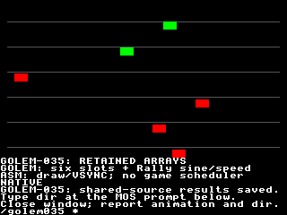

# GOLEM-035 — Retained typed arrays and Rally tables

The first array tranche works on both backends. Typed indexed reads/writes,
read-only tables and explicit initialization share the same retained layout and
checked semantics. Stock and actual Xtensa qualification pass. Rally accepted the
storage contract; its six route records and 257 sine values remain exact. The Author accepted Oryx human review; retrieved results match all
1,302 observations/12,912 bytes. The Author explicitly approved commit/push and proceeding to GOLEM-036. Production src and generic SDK/runtime code are unchanged.

## Review the program

Read [animation.golem](animation.golem). Six independent markers bounce across
six lanes, moving green to the right and red to the left. Speeds derive from
Rally's retained route-speed column; small vertical movements use its exact
257-value sine table. Position, velocity, phase, colour and sine lookup all run
in Golem. Assembly draws the markers/lane guides and paces with VSYNC. The caption
alternates BUFFERED/NATIVE every 12 frames while sharing the same retained arrays.
This is a storage demonstration, not Rally gameplay or a 120/30-Hz scheduler.

On Oryx, use one terminal:

```bash
cd ~/Agon/mystuff/golem/docs/tasks/GOLEM-035/.emulator
./fab-agon-emulator
```

Watch all six markers. Follow the onscreen `dir` instruction, close the emulator,
and report whether animation and keyboard worked. The agent retrieves results;
no second-terminal verifier is needed. The launcher removes stale results before
rerunning. Both Golem programs are deployed beside the guest results.



## Supported source and storage

```golem
uint16 slot = 0
sint16 selected = 0
Array sint16 lateral(0:5) = Fill(0)
ReadOnly Array sint16 heading(0:5) = Values(0,1920,0,0,-1920,0)
Sub update
    lateral(slot) = lateral(slot) + 1
    selected = heading(slot)
EndSub
```

1. `Array uint16` and `Array sint16` declare homogeneous one-dimensional retained
   storage. Bounds are inclusive, ascending and consecutive. Numeric indices may
   be uint16 or sint16 expressions, including negative indices when declared;
   negative values do not mean reverse indexing. No implicit type conversion.
2. `Fill(literal)` explicitly initializes every element. `Values(...)` requires
   exactly one typed literal per element. A declaration without an initializer
   requires build mapping `--array-data NAME=PATH`, containing exactly the packed
   little-endian initial bytes. Source contains no filenames or MOS loader logic.
   `ReadOnly Array` rejects source writes, including in unselected branches.
3. Current single-block policy admits at most 32767 two-byte elements per array,
   with bounds within -32768..65535. These are implementation/admission choices,
   not physical memory ceilings. Full-world Rally coordinates need GOLEM-036's
   wider types; this tranche never silently narrows them into sint16.
4. The compiler generates one application-owned buffer per array, separate from
   the root and both private backends. `common-install.bin` initializes root AND
   arrays; `arrays-install.bin` initializes arrays alone. Repeating installation
   resets that storage. Ordinary calls do not reset arrays. Native unload and
   either private cleanup preserve them. Assembly owns installation and lifetime.
5. Optional `interface.arrays` descriptors publish name/type/buffer/offset/bytes,
   inclusive lower/upper/count, element_bytes, access, owner and initial_data.
   Artifact hashes identify exact initial images; external input paths/hashes are
   in delivery inputs. `layout.inc` exports corresponding buffer/type/size/bounds
   equates. IDs are generated, including relocation; do not infer them by ordinal.
6. The accepted root-v1 header/four-role ABI remains unchanged. Array descriptors
   are additional fixed build metadata, not dynamic writable root descriptors.
   Native preflight checks actual array shapes, then each access acquires/releases
   one range. Peak is three live leases: argument, root and one array. Stock relies
   on the truthful installed shape/lifetime invariant. Neither is snapshot or
   concurrency synchronization. ReadOnly is source permission, not protection
   against a trusted assembly installer changing a buffer while quiescent.

Buffered access checks the index, computes a proven bounded byte offset in
private scratch, patches a small copy command, then executes it. Native code uses
a short-lived SDK view. Array contents are retained data, not embedded native C
constants. No per-call whole-array scan, readback or copy verification is added.

## Failure behavior

1. A store evaluates/checks its index first, then evaluates the RHS, then stores
   once. A validly evaluated out-of-range index reports language status 5 before
   RHS evaluation. Arithmetic/conversion faults retain their existing codes.
2. Failed reads preserve the destination. Failed writes preserve the element
   and adjacent data. Earlier effects remain; no rollback is implied. Existing
   scalar Bounds/conversion checks still apply to loaded elements. Invalid
   literal indices reject at compile time rather than emitting a guaranteed fault.
3. Native missing/wrong-size arrays report interface 8 and the actual SDK result,
   before source effects. This physical-storage check is not available on stock;
   assembly must uphold the installation invariant. Host-owned runtime_result
   remains untouched by generated code. Failed calls publish no new success marker.
4. Float/wide/multidimensional arrays, array-valued functions, whole-array copies,
   dynamic views, paired divmod array destinations and array For counters are
   outside this first profile. Existing scalar constructs remain available.

## Evidence

1. [Host checks](host-checks.json): 2,838 model/generated native-C cases over default
   and relocated packages, ASan/UBSan, first/last/invalid/signed/high bounds,
   index-before-RHS ordering, overflow, short-circuit skipping, persistence and
   cleanup. Scalar executable/layout outputs match accepted D0 exactly.
2. [Rally/animation checks](animation-checks.json): 866 independent host cases,
   all six route records and 257 sine values, six slots and 600 motion frames.
   [Destination admission](admission-checks.json) adds eight Bounds/conversion
   cases with released native leases; [frontend checks](frontend-checks.json)
   cover 23 rejections, array-only programs and an actual assembler consumer
   including a negative bound. Maintained compiler checks pass.
3. [Stock access](evidence/stock-jit.json): 26 calls, 1,090 observations/2,180 bytes.
   [Stock Rally data/motion](evidence/meter-stock-jit.json): 324 calls, 1,053
   observations/2,106 bytes, all 257 sine lookups, all six route records and 60
   six-slot movement steps. Host scripts collect diagnostic results; these reads
   are qualification instrumentation, not required runtime call traffic.
4. Actual Xtensa default [JIT](evidence/hybrid-jit.json)/
   [interpreter](evidence/hybrid-interp.json), relocated
   [JIT](evidence/relocated-jit.json)/[interpreter](evidence/relocated-interp.json):
   each passes 52 named calls, 2,046 observations/20,460 bytes, including native
   missing/short/long arrays and exact retention after both private cleanups.
5. Visual [JIT](evidence/review-jit.json)/[interpreter](evidence/review-interp.json):
   each passes 601 invocations across 600 frames, 1,302 observations/12,912 bytes,
   all 56,320 final playfield pixels and actual MOS prompt return. JIT took 36.159s;
   interpreter 62.867s on Oryx. These are emulator qualification durations, not
   calibrated physical-frame timing. Human visual/keyboard acceptance is pending.
6. [Rebuild checks](reproducibility-checks.json) preserve executable/storage bytes
   across independent output directories and tie them to qualified package/source
   hashes. [Exported source check](export-checks.json) independently rebuilds 14
   compiler outputs from the complete source closure. [Immutable delivery pointer](delivery.json) identifies all three
   package manifests, the complete local source closure and captured receipts.
   The baseline is D0/1a1f303 and scalar 25901e5, SDK 33a554c unchanged.

The six-marker native module uses 6,992 text bytes, 268 data/rodata bytes and an 8,264-byte
package. Static module frames total 160 bytes (entry 128 + helper 32), excluding
firmware/service frames, inside the existing 512-byte budget. Retained tables/state
occupy 634 array bytes plus 142 root bytes. No admission limit or firmware changed.
A frame sends a six-byte Golem call, six-byte resident drawing call and three-byte
VSYNC swap: 15 wire bytes independent of the six position updates. Caption changes
and initial installation are separate. Native C contains descriptors/logic, with
all table values installed once in retained buffers.

## Build and qualification

The compiler remains C++; use project Python only for tooling. Examples:

```bash
.venv/bin/python docs/tasks/GOLEM-035/host_checks.py
.venv/bin/python docs/tasks/GOLEM-035/frontend_checks.py
.venv/bin/python docs/tasks/GOLEM-035/animation_checks.py
.venv/bin/python docs/tasks/GOLEM-035/admission_checks.py
.venv/bin/python docs/tasks/GOLEM-035/reproducibility_checks.py
.venv/bin/python docs/tasks/GOLEM-035/fixture.py all
.venv/bin/python docs/tasks/GOLEM-035/stage_oryx.py
```

`animation_checks.py` expects the animation package built first with
`build_delivery.py`, mapping duration/speed/heading/rate/sine to the matching
`data/*.dat` files using repeated `--array-data NAME=PATH`. The immutable source
closure carries those files, frozen baseline verification inputs and current src
include dependencies. Select the pinned SDK with `GOLEM_VDPLET_SDK` when rebuilding
outside the ordinary repository layout. Host executable hashes are machine
receipts, not cross-architecture binaries. Do not build into an immutable bundle.

On the configured qualification host, `profile.py VARIANT` prepares stopped
profiles and `qualify.py VARIANT --engine jit|interp` runs headless checks.
`stage_oryx.py --retrieve` gathers automated receipts; a later human run requires
separate result retrieval. Canonical network/emulator instructions still apply.
No physical target was flashed.

Rally accepted this storage profile in its retained acceptance receipt. Signed
minimum/-1 division overflow status 6 is now mutually agreed and recorded for
GOLEM-036; no signed division was implemented here. Its renderer proposal and
argument/root lease-budget detail are recorded in GOLEM-037 for later work.

The Author subsequently reported the tests look good. [Retrieved human results](evidence/human-review.json)
match all 1,302 observations/12,912 bytes and runtime/fixture hashes pass. The
immutable delivery keeps its original pre-review status as provenance. Explicit
commit/push approval remains pending.

The Author subsequently explicitly approved commit/push of all pending work.
The immutable delivery keeps its original candidate status as provenance.
