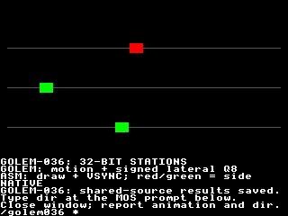

# GOLEM-036 — Wide integer foundation

The first D1b tranche adds uint32/sint32 globals and arrays, checked addition and
subtraction, six comparisons and checked integer conversions to both task-local
backends. Host, stock VDP and actual Xtensa JIT/interpreter qualification pass.
The same source drives a 600-frame Oryx review, staged and stopped. The Author accepted the Oryx review; retrieved results match all 590 observations/5,846 bytes. The Author subsequently explicitly approved commit/push. Wide multiplication/division,
shifts and full Rally simulation replay are subsequent reviewed steps; production
src and the generic SDK/runtime are unchanged.

## Review the program

Read [animation.golem](animation.golem). Three markers bounce horizontally along
three grey lanes. Their world stations are around 3,200,000; Golem subtracts a
shared world origin before explicitly converting the relative position to uint16.
Each marker also carries signed Q8 lateral state between −38,400 and +38,400:
red means negative lateral position, green means nonnegative. Colour changes are
independent of horizontal direction. Golem computes every moving coordinate,
direction and colour, using retained 32-bit arrays. Assembly draws the three
markers/guides and paces with stock VSYNC. The caption alternates BUFFERED/NATIVE
every 12 frames while the same state continues. The wide tick counter crosses
65,535 and finishes at 66,100. This is a numeric/storage demonstration, not Rally
physics, a renderer-helper integration or an autonomous 120/30-Hz scheduler.

On Oryx, use one terminal:

```bash
cd ~/Agon/mystuff/golem/docs/tasks/GOLEM-036/.emulator
./fab-agon-emulator
```

Watch all three markers, follow the onscreen `dir` instruction, then close the
emulator and report whether animation and keyboard worked. The agent retrieves
and verifies the saved results. No separate verifier command is needed. Reruns
remove stale results automatically. The Golem source is deployed beside the guest.



## Supported source

```golem
uint16 slot = 0
uint32 origin = 3200000
uint32 station Bounds(0, 6553600) = 3200032
sint32 lateral Bounds(-38400, 38400) = -38400
uint16 screenX = 32
bool negativeSide = true
Array uint32 stations(0:2) = Values(3200032, 3200128, 3200224)
Array sint32 laterals(0:2) = Values(-38400, 0, 38400)
Sub step
    station = stations(slot) + 2
    stations(slot) = station
    lateral = laterals(slot) + 256
    laterals(slot) = lateral
    screenX = uint16(station - origin)
    negativeSide = lateral < 0
EndSub
```

1. uint32 covers 0..4,294,967,295; sint32 covers −2,147,483,648..2,147,483,647.
   Globals and elements use four packed little-endian bytes, including unaligned
   globals after two-byte values. Tags 7/8 identify uint32/sint32; existing tags,
   root-v1 and prior installed narrow layouts retain their meaning.
2. Operands have one declared type. No implicit widening/mixed signedness is
   introduced. `uint32(narrow + 1)` still performs a narrow addition before casting;
   `uint32(narrow) + 1` performs the addition wide. Explicit integer conversions
   among uint16/sint16/uint32/sint32 are numeric and checked, including signedness
   changes and narrowing. They never wrap or reinterpret bits.
3. `+` and `-` check the mathematical result at its source width. All six same-type
   comparisons (`== != < > <= >=`) work, including signed extrema and full
   unsigned values above 0x7fffffff. Existing Boolean short circuit, If and finite
   For constructs can consume these values without changing their semantics.
4. Bounds are inclusive numeric limits. A failed Bounds/conversion reports
   language status 32; addition overflow 1, subtraction overflow/underflow 2, logical
   index failure 5. The failed destination/element stays unchanged, earlier
   completed effects remain, execution returns and root success does not advance.
   Physical native array faults use interface 8 plus the actual SDK result.
5. Array uint32/sint32 retains GOLEM-035's one-dimensional inclusive bounds,
   Fill/Values or exact build-supplied initialization, ReadOnly source permission
   and application ownership. Each four-byte array admits at most 16,383 elements
   (65,532 bytes) in the current one-block policy. Declared bounds remain within
   −32,768..65,535. Indices remain uint16/sint16; explicitly narrow a wide index
   before access. Index checking precedes a store's RHS evaluation.
6. Wide multiplication, divmod, shifts, wide↔float conversion and source 64-bit
   types reject explicitly in this tranche. Existing narrow arithmetic and
   bounded float32 behavior remain available. Signed division's agreed future
   overflow 6/zero 4 and rounding contract is recorded in the main task plan;
   no division implementation is claimed here.

Assembly owns installation, updates, invocation, pacing and cleanup. Generated
layout/call symbols publish actual IDs/offsets/widths. Native preflight checks
array shapes and uses bounded views; stock depends on the installed shape/lifetime
invariant. Arrays/root survive backend changes, native unload and private cleanup.
There is no per-call whole-array scan or post-copy readback verification.

## Evidence and limits

1. [Host checks](host-checks.json): 3,872 model/generated-C cases over default and
   relocated layouts, ASan/UBSan, carry/sign boundaries, all comparisons,
   conversions, Bounds, failed stores, prior effects, skipped conversion,
   physical faults, retained cleanup and random pairs. Accepted GOLEM-035
   executable/layout/native-C outputs remain byte-identical, including its float
   support. Maintained production compiler checks pass.
2. [Frontend checks](frontend-checks.json): 15 grammar/admission rejections,
   extreme literals, signed/nonzero array bounds and a real assembler consumer.
   [Maximum-array checks](array-boundary-checks.json) exercise first/middle/last
   four-byte elements through byte offset 65,528, including adjacent-byte
   preservation and invalid access, on the buffered model and sanitized native C.
3. [Rally checks](rally-checks.json): all 8 published addition/subtraction and 29
   conversion vectors representable within source 32-bit domains match their
   independent published results/errors directly. Two conversion inputs outside
   those domains remain deferred, as do multiplication/division/shift and full
   route/contact/projection replay. Two additional runtime cases prove widening
   before versus after a narrow overflowing expression.
4. [Animation host checks](animation-checks.json): 600 source steps match buffered
   model and sanitized native C, including every root/array byte and final tick.
   [Stock probes](evidence/stock-jit.json): 30 calls, 1,083 observations/2,166 bytes.
   [Stock motion](evidence/meter-stock-jit.json): 60 calls,180 observations/360 bytes.
5. Actual Xtensa default [JIT](evidence/hybrid-jit.json)/
   [interpreter](evidence/hybrid-interp.json), relocated
   [JIT](evidence/relocated-jit.json)/[interpreter](evidence/relocated-interp.json):
   each passes 60 named calls, 2,311 observations/23,110 bytes. Missing/short/long
   arrays fail before source effects; private cleanup/unload preserves storage.
6. Visual [JIT](evidence/review-jit.json)/[interpreter](evidence/review-interp.json):
   each passes 600 calls/frames, 590 observations/5,846 bytes, all 56,320 final
   playfield pixels and actual MOS return. Oryx durations were 24.914s/38.138s;
   these are functional emulator qualification times, not physical-frame timing.
7. [Reproducibility](reproducibility-checks.json) independently rebuilds all three
   package executables/storage; target hashes remain identical. Immutable source,
   packages and receipts are identified by [delivery.json](delivery.json).
   The delivery status records automatic qualification with human review pending.

## Resources and traffic

| Package | Root / arrays bytes | Buffered installation | Native text / data | Sum of module static frames |
| --- | --- | --- | --- | --- |
| Probe |154 /32 |34,392 bytes |2,648 /268 bytes |176 bytes |
| Relocated probe |154 /32 |34,392 bytes |2,656 /268 bytes |176 bytes |
| Animation |126 /54 |17,700 bytes |3,256 /268 bytes |192 bytes |

Native modules pass the existing SDK image validator without changing limits.
Frame sums conservatively include all module functions but exclude firmware/
service caller frames; this is not composed renderer/helper stack qualification.
Peak live views remain arguments+root+one array=3. The animation's common install
is 278 bytes, native wrapper install 60 bytes, and native image 4,540 bytes. The
buffered setup is larger because comparisons/arithmetic expand into resident
commands; no elaborate optimizer is added.

An ordinary frame remains 15 eZ80→VDP wire bytes: named calculate call 6, resident
draw call 6, VSYNC swap 3. Source arrays retain all marker positions; no per-marker
host position updates are needed. Caption changes, qualification observations,
module installation and load/unload protocol are separate traffic. Generated
native C uses checked 64-bit intermediates only where needed for 32-bit arithmetic;
it does not add source 64-bit types or make stock calculations native.

## Reproduce

Run in the repository root with its existing .venv and pinned SDK/toolchains:

```bash
.venv/bin/python docs/tasks/GOLEM-036/host_checks.py
.venv/bin/python docs/tasks/GOLEM-036/build_delivery.py docs/tasks/GOLEM-036/animation.golem docs/tasks/GOLEM-036/build/animation
.venv/bin/python docs/tasks/GOLEM-036/frontend_checks.py
.venv/bin/python docs/tasks/GOLEM-036/rally_checks.py
.venv/bin/python docs/tasks/GOLEM-036/array_boundary_checks.py
.venv/bin/python docs/tasks/GOLEM-036/animation_checks.py
.venv/bin/python docs/tasks/GOLEM-036/fixture.py all
.venv/bin/python docs/tasks/GOLEM-036/reproducibility_checks.py
```

SDK source/tool hashes and committed GOLEM-035 baseline are pinned in
baseline-receipt.json. Immutable exported compiler sources rebuild independently
of the working task files; the SDK/toolchain remains an external pinned
prerequisite. Qualification/staging tooling is task-local. No physical target
was flashed, no helper/scheduler integration or SDK capacity change was performed.
