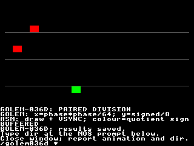

# GOLEM-036 — Paired wide division and remainder

This third D1b tranche adds `(q,r)=divmod(n,d)` for matching uint32/sint32 globals,
with common checked semantics on stock buffered commands and native VDPlets.
Host, stock and actual Xtensa JIT/interpreter qualification pass; the Oryx animation
was accepted by the Author; saved results match all 488 observations / 4,826 bytes. The Author explicitly approved commit/push. Previous foundation/multiplication sources,
packages and profiles remain intact. Wide shifts/exact helpers/full Rally replay
remain later work. Production src and generic SDK/runtime are unchanged.

## Review

Read [animation.golem](animation.golem). Three markers follow curves: horizontal
position uses quotient and remainder from `phase*phase / 64`; vertical movement
uses signed quotient/remainder from `(phase-64)*3 / 8`. Green means a nonnegative
vertical quotient, red means negative. Fractions/remainders remain in arrays.
Golem calculates every position/direction/colour. Assembly draws the markers and
grey guides and paces with VSYNC. BUFFERED/NATIVE alternates every 12 frames,
sharing the same retained state. The finite run is 300 frames; tick ends at 65,800.

On Oryx, use one terminal:

```bash
cd ~/Agon/mystuff/golem/docs/tasks/GOLEM-036/division/.emulator
./fab-agon-emulator
```

Watch the three curved paths, follow the onscreen `dir` instruction, close and
report the result. The agent retrieves saved observations. No second-terminal
verifier is needed; the launcher removes stale results before reruns.



## Semantics

```golem
uint16 speed = 180
sint16 heading = -32767
sint32 product = 0
sint32 delta = 0
sint32 residual = 0
Sub routeStep
    product = sint32(speed) * 2 * sint32(heading)
    (delta,residual) = divmod(product,12800)
EndSub
```

This produces product −11,796,120, quotient −921 and remainder −7,320 exactly.

1. Both destinations are distinct declared globals of the same supported type:
   uint32, sint32 or the existing uint16 form. Arguments use that same type and
   evaluate once, left to right. Inputs may alias either destination, and can
   include checked expressions and indexed array reads. No implicit widening,
   mixed signedness, signed16 pairing or array destinations are added.
2. Signed quotient truncates toward zero. Remainder is `n-q*d`, zero or the
   numerator's sign, with `abs(r)<abs(d)`. This differs from floor division of
   negative numbers; it does not implement the future arithmetic-shift contract.
3. Zero divisor is language status 4. Sint32 minimum divided by −1 is status 6.
   Both outputs stay unchanged on either error; earlier effects remain and root
   success does not advance. Source-expression errors occur before division and
   retain their own codes. No rollback or source 64-bit type is introduced.
4. Both results pass destination Bounds before either store. A failure on the
   quotient OR remainder is status 32 and preserves BOTH outputs. Prior effects,
   including an earlier successful divmod in the same invocation, remain.
5. Logical array admission still precedes the consuming computation; invalid
   indices preserve outputs. Unselected branches skip the pair. Interface/SDK
   errors remain separate from language errors. Existing storage, tags, root-v1,
   cleanup and lease ownership rules are unchanged.
6. Metadata publishes zero_divisor 4 for new wide pairing, and
   signed_division_overflow 6 where signed pairing occurs, including nested pairs
   in programs without arrays. Prior package artifacts retain their original
   metadata and executable layouts. Wide float casts, general `/` expressions,
   shifts and wider-intermediate helpers remain outside this slice.

## Implementation and resources

Stock emission uses one finite shared 32-round unsigned long-division kernel.
Each round doubles a private remainder, brings down one numerator bit, compares
with the divisor and conditionally subtracts/sets a quotient bit. The remainder
reserves five value bytes plus a carry byte; the divisor's upper byte is zero.
Signed inputs become unsigned magnitudes, including minimum sint32. Signs are
restored after the kernel; minimum/−1 and zero exit before it. Both four-byte
results are copied into private snapshots, admitted, then stored. Comparison
helpers have fixed depth; no unbounded resident loop or growing recursion.

Native emission uses admitted 32-bit C division/remainder, with explicit zero and
minimum/−1 guards before signed operations. The reference model independently
uses absolute integer division and reconstructs signed remainder; it does not
use floating point to approximate quotient.

| Package | Buffered installation | Native text / data | Sum of module static frames |
| --- | --- | --- | --- |
| Probe |26,486 bytes |1,832 /268 bytes |192 bytes |
| Relocated probe |26,486 bytes |1,832 /268 bytes |192 bytes |
| Animation |25,205 bytes |3,276 /268 bytes |192 bytes |

Modules pass unchanged SDK admission. Frame sums cover module functions, excluding
firmware/service callers; this is not composed renderer stack qualification.
Peak views remain arguments+root+one array=3. Animation common installation is 334
bytes, native wrapper installation 60 bytes and native image 4,560 bytes.

An ordinary frame still uses 15 eZ80→VDP wire bytes: calculate 6, draw 6, VSYNC 3.
State and fractions stay resident. Setup/caption changes/qualification reads are
separate traffic. Emulator durations are functional evidence, not calibrated
physical-frame timing. No firmware/SDK capacity change or physical flashing.

## Evidence

1. [Host checks](host-checks.json): 2,528 model/sanitized generated-C cases across
   default/relocated layouts. All 100 published Rally division vectors and 600
   supplied route-product divisions match independently expected quotients/errors
   in each layout. Remainder identities/sign/magnitude, extrema, random pairs,
   zero/minimum faults, argument order, aliasing, both Bounds failures, array
   input faults, prior effects and repeated pairs pass. This is the division step
   of supplied products, not full route/world/contact/projection replay.
2. [Frontend checks](frontend-checks.json): six type/destination exclusions,
   sanitizer-checked nested signed pair metadata without arrays and a real
   assembler consumer. Previous multiplication executable/layout/native-C bytes
   remain identical. Maintained production compiler checks pass.
3. [Animation checks](animation-checks.json): 300 source steps match model/native C
   for every root/array byte. [Stock probes](evidence/stock-jit.json): 26 calls,
   818 observations/1,636 bytes. [Stock motion](evidence/meter-stock-jit.json): 60
   calls, 208 observations/416 bytes.
4. Actual Xtensa default [JIT](evidence/hybrid-jit.json)/
   [interpreter](evidence/hybrid-interp.json) and relocated
   [JIT](evidence/relocated-jit.json)/[interpreter](evidence/relocated-interp.json):
   each passes 52 calls, 1,799 observations/17,990 bytes, physical shape failures
   and retained cleanup. One initial parallel default JIT run made no final
   observation file; it was interrupted and its [logs/disposition](evidence/hybrid-incomplete.json)
   retained. Subsequent serialized JIT and interpreter pass. Cause is unestablished;
   no emulator/runtime fix is claimed.
5. Visual [JIT](evidence/review-jit.json)/[interpreter](evidence/review-interp.json):
   300 frames/calls, 488 observations/4,826 bytes, all 56,320 final playfield pixels
   and actual MOS return. Oryx durations were 33.346s/71.872s; these are emulator
   qualification times. The Author accepted human review; saved observations and runtime/fixture identities pass.
6. [Reproducibility](reproducibility-checks.json) independently rebuilds all three
   package executables/storage, retaining qualified target hashes. Immutable
   sources/packages/receipts are identified by [delivery.json](delivery.json).
   Its pending-human status is a historical snapshot, not rewritten later.

## Reproduce

Use the existing repository .venv and pinned SDK/toolchains:

```bash
.venv/bin/python docs/tasks/GOLEM-036/division/host_checks.py
.venv/bin/python docs/tasks/GOLEM-036/division/build_delivery.py docs/tasks/GOLEM-036/division/animation.golem docs/tasks/GOLEM-036/division/build/animation
.venv/bin/python docs/tasks/GOLEM-036/division/frontend_checks.py
.venv/bin/python docs/tasks/GOLEM-036/division/animation_checks.py
.venv/bin/python docs/tasks/GOLEM-036/division/fixture.py all
.venv/bin/python docs/tasks/GOLEM-036/division/reproducibility_checks.py
```

Pin/source closure and tool hashes are in baseline-receipt.json. The SDK/toolchain
remain external prerequisites. Headless profiles should be qualified separately;
human launch uses only the staged local wrapper above. All reports/prototypes
remain task-local pending separately agreed production promotion.
