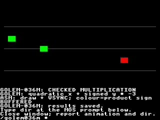

# GOLEM-036 — Checked wide multiplication

This second D1b tranche adds checked uint32/sint32 multiplication to both
shared-source backends. Host, stock VDP and actual Xtensa JIT/interpreter checks
pass. The Author accepted the Oryx animation; retrieved results match all 460 observations / 4,546 bytes. The Author subsequently explicitly approved commit/push.
The accepted foundation sources/packages are preserved in the parent directory.
Wide division, shifts and full Rally replay remain later steps; production src
and generic SDK/runtime code are unchanged.

## Review

Read [animation.golem](animation.golem). Three markers accelerate horizontally
along a quadratic path (`16 + phase * phase`) and move vertically using a signed
product (`tilt * -3`). Green means the signed product is nonnegative; red means
negative. Golem calculates positions, directions and colours from retained arrays.
Assembly draws markers and grey lane guides, then paces with stock VSYNC.
BUFFERED/NATIVE alternates every 12 frames while sharing the same state. The
finite run lasts 300 frames, finishing with the wide tick counter at 65,800.

On Oryx, in one terminal:

```bash
cd ~/Agon/mystuff/golem/docs/tasks/GOLEM-036/multiplication/.emulator
./flexe-agon-emulator
```

Watch the three curved paths, follow the onscreen `dir` instruction, close the
emulator and report the result. The agent retrieves saved observations; there is
no separate verifier command. Reruns remove stale results automatically.



## Semantics

```golem
uint16 speed = 180
sint16 heading = 32767
sint32 routeProduct = 0
Sub compute
    routeProduct = sint32(speed) * 2 * sint32(heading)
EndSub
```

1. `*` has higher precedence than `+`/`-`; operands evaluate once, left to right.
   Nested products retain intermediate results independently. No implicit operand
   widening is introduced: explicitly convert narrow operands before multiplying
   when the intermediate needs 32 bits. This example produces 11,796,120 exactly.
2. The full mathematical product must fit the declared integer type. Overflow
   reports language status 3, preserves the failed destination/array element and
   exits without publishing root success. Earlier effects remain. Signed minimum
   times −1 fails; signed minimum times 1 succeeds. Negative zero products become
   integer zero. Destination Bounds still apply afterward with status 32.
3. A store checks its index before evaluating the RHS. Unselected/short-circuited
   runtime products are skipped. Invalid constant products are compile errors,
   consistent with existing constant-intermediate admission, including constants
   in branches that would be skipped at runtime.
4. Storage, type tags, generated layout symbols, root-v1, ownership and SDK lease
   rules retain the accepted foundation contract. Native unload/private cleanup
   preserves shared root/arrays. There is no runtime copy readback/checksum.
5. Wide divmod/shifts/float casts and source 64-bit types remain unavailable. The
   future signed-division overflow code 6 is distinct from multiplication's 3.
   This tranche does not implement route division, collision replay or scheduling.

## Implementation and resource bounds

The stock backend installs one shared finite kernel per package. It evaluates
32 multiplier bits, conditionally adds an eight-byte shifted magnitude to an
eight-byte product, and doubles the private shifted value between rounds. Scratch
reserves carry bytes. The maximum unsigned32 product fits unsigned64 exactly;
signed32 inputs are converted to unsigned magnitudes, including −2,147,483,648.
After the kernel, upper bytes and signed result limits are checked before the
four-byte result is copied. Each expression snapshots its result so a subsequent
nested product can safely reuse the kernel. No unbounded loop or growing call
stack is introduced.

Generated native C uses checked uint64/int64 intermediate products of admitted
32-bit operands, then stores four bytes. The compiler's constant evaluator uses
an unsigned intermediate for unsigned products, avoiding signed host overflow.
These private intermediates do not add source-language 64-bit arithmetic.

| Package | Buffered installation | Native text / data | Sum of module static frames |
| --- | --- | --- | --- |
| Probe | 24,885 bytes | 1,896 / 268 bytes | 176 bytes |
| Relocated probe | 24,885 bytes | 1,900 / 268 bytes | 176 bytes |
| Animation | 22,613 bytes | 3,740 / 268 bytes | 208 bytes |

All modules pass the unchanged SDK validator. Frame sums include module functions,
exclude firmware/service callers, and do not qualify composed renderer stack.
Peak views remain arguments+root+one array = 3. Animation common installation is
340 bytes, wrapper installation 60 bytes and native image 5,024 bytes.

An ordinary frame uses 15 eZ80→VDP bytes: calculate call 6, resident draw call 6,
VSYNC swap 3. Positions stay resident. Setup, backend-caption changes and numerical
qualification reads are separate traffic. Emulator timings are functional evidence,
not physical hardware benchmarks. No board was flashed or capacity policy changed.

## Evidence

1. [Host checks](host-checks.json): 1,682 model/sanitized generated-C cases across
   default/relocated layouts: full unsigned/signed extrema, sign combinations,
   random pairs, powers of two, zero cancellation, nested products, precedence,
   narrow-before/after widening, evaluation order, Bounds, array stores, skipped
   products and physical faults. All six published Rally multiplication vectors
   match their independent expected results/errors directly in each layout.
2. [Frontend checks](frontend-checks.json): six constant/type/target exclusions and
   an actual assembler consumer. [Animation checks](animation-checks.json): all
   300 source steps match model/native C byte-for-byte for root and nine arrays.
   Accepted foundation executable/layout/native-C files remain identical; maintained
   production compiler tests pass.
3. [Stock probes](evidence/stock-jit.json): 25 calls, 611 observations/1,222 bytes.
   [Stock motion](evidence/meter-stock-jit.json): 60 calls, 200 observations/400 bytes.
4. Actual Xtensa default [JIT](evidence/hybrid-jit.json)/
   [interpreter](evidence/hybrid-interp.json) and relocated
   [JIT](evidence/relocated-jit.json)/[interpreter](evidence/relocated-interp.json):
   each passes 50 calls, 1,377 observations/13,770 bytes, physical shape failures
   and retained cleanup. Visual [JIT](evidence/review-jit.json)/
   [interpreter](evidence/review-interp.json) each pass 300 frames/calls,
   460 observations/4,546 bytes, all 56,320 final playfield pixels and MOS return.
   The Author accepted human review; saved observations and fixture identities pass.
5. [Reproducibility](reproducibility-checks.json) rebuilds all three packages in
   independent directories, preserving target executable/storage hashes. The
   immutable delivery/source closure is identified by [delivery.json](delivery.json).
   Its original qualification status remains historical after later reviews.

## Reproduce

Use the repository's existing .venv and pinned SDK/toolchains:

```bash
.venv/bin/python docs/tasks/GOLEM-036/multiplication/host_checks.py
.venv/bin/python docs/tasks/GOLEM-036/multiplication/build_delivery.py docs/tasks/GOLEM-036/multiplication/animation.golem docs/tasks/GOLEM-036/multiplication/build/animation
.venv/bin/python docs/tasks/GOLEM-036/multiplication/frontend_checks.py
.venv/bin/python docs/tasks/GOLEM-036/multiplication/animation_checks.py
.venv/bin/python docs/tasks/GOLEM-036/multiplication/fixture.py all
.venv/bin/python docs/tasks/GOLEM-036/multiplication/reproducibility_checks.py
```

Baseline source/tool hashes are in baseline-receipt.json. The immutable export
contains all compiler source dependencies; the pinned external SDK/toolchain is
still required. Reports/scripts remain in this task silo, pending any separately
agreed production promotion.
