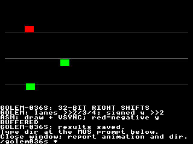

# GOLEM-036 — Typed 32-bit right shifts

This fourth D1b tranche implements `>>` on both shared-source backends: sint32
arithmetic/sign-extending and uint32 logical/zero-filling shifts. Host, stock VDP
and actual Xtensa qualification pass. The Oryx animation is staged/stopped for
human review, now accepted; all 382 observations / 3,766 bytes match. The Author explicitly approved commit/push after an empty mailbox check. Previous division sources/packages
remain intact. Golem qualifies language primitives/packages; Rally owns its
actual game replay and validation. Production src and generic SDK are unchanged.

## Review

Read [animation.golem](animation.golem). The three lanes use unsigned shifts by
2, 3 and 4, so the markers have different horizontal ranges. Signed vertical
movement uses shift by 2: red means negative vertical displacement, green means
nonnegative. Golem computes positions/directions/colours from retained arrays;
assembly draws markers/guides and paces VSYNC. BUFFERED/NATIVE alternates every 12
frames with continuous shared state. The finite run is 300 frames, tick ending
at 65,800. This is a language demonstration, not Rally game code.

On Oryx, in one terminal:

```bash
cd ~/Agon/mystuff/golem/docs/tasks/GOLEM-036/right-shift/.emulator
./fab-agon-emulator
```

Watch the three ranges/curves, follow the onscreen `dir` instruction, then close
and report. The agent retrieves saved observations. No separate verifier command;
reruns clear stale results automatically.



## Source and semantics

```golem
sint32 value = -65
uint16 bits = 6
sint32 result = 0
uint32 mask = 4294967295
uint32 high = 0
Sub scale
    result = value >> bits
    high = mask >> 31
EndSub
```

This assigns result −2 and high 1. Truncating divmod of −65 by 64 gives quotient −1;
arithmetic right shift keeps the floor semantics required by interpolation.

1. The left operand and result are uint32 or sint32. Counts are typed uint16
   expressions in 0..31; explicit conversions are required for other count types.
   Signed16 operands require explicit widening. No count masking or implicit
   widening/signedness changes occur. Count 0 preserves the value; 31 retains the
   unsigned high bit or signed sign. Negative signed values use sign extension.
2. Invalid constant counts reject compilation, including skipped source branches.
   Invalid dynamic counts report language 32 before writing the destination/element.
   Existing Bounds checks also report 32. Prior effects remain and root success
   does not advance after failure. Count-expression/index/arithmetic failures
   retain their own codes and left-to-right ordering.
3. Multiplication/addition bind more tightly than shifts; comparisons bind below
   shifts. `a + b >> bits + 1` means `(a + b) >> (bits + 1)`. Chains associate left
   to right. Parentheses override grouping. The two `>` characters are adjacent;
   ordinary `>`/`>=` comparisons retain their meaning. Operands evaluate once.
4. Typed array reads/writes, count arrays, checked casts, Boolean short circuit,
   finite control flow and root/storage ownership retain their prior contracts.
   Store indices are checked before RHS evaluation. Private cleanup/native unload
   preserves shared root and all application arrays.
5. Left shifts, other bitwise operators, signed16/float shifts, wide float casts,
   exact wider projection helpers and renderer linking remain outside this slice.
   `^` remains proposed XOR; this does not add exponentiation or those operators.

## Implementation and resources

The stock backend installs one private 256-byte byte-halving table and one shared
one-bit round. Each round processes low-to-high bytes, looks up half of each
original byte and inserts the low bit from its untouched neighbour into bit 7.
The top byte receives zero or the captured sign. A private three-byte counter
has a carry landing byte; the round runs only while its admitted count is nonzero,
at most 31 times. Result snapshots make nested shifts safe across kernel reuse.
No unbounded loop, post-copy readback or content scanning is introduced.

Native C shifts unsigned 32-bit values after checking the count, then explicitly
fills sign bits when appropriate. Shift 0 bypasses sign-fill shifting, avoiding
undefined shift-by 32. The host constant evaluator follows the same unsigned
bit-pattern rule. The independent Python oracle uses exact floor division.

| Package | Buffered installation | Native text / data | Sum of module static frames |
| --- | --- | --- | --- |
| Probe |32,164 bytes |2,436 /268 bytes |192 bytes |
| Relocated probe |32,164 bytes |2,444 /268 bytes |192 bytes |
| Animation |21,813 bytes |3,108 /268 bytes |192 bytes |

All modules pass existing SDK limits. Frame sums cover module functions, excluding
firmware/service callers; no composed renderer-stack qualification is inferred.
Peak live views remain arguments+root+one array=3. The animation's common install
is 294 bytes, wrapper install 60 bytes and native image 4,392 bytes.

Ordinary frame wire remains 15 eZ80→VDP bytes: calculate 6, resident draw 6, VSYNC 3.
No per-marker host updates are needed. Setup, captions and qualification reads
are separate traffic. No SDK/firmware/capacity changes or physical flashing.

## Evidence

1. [Host checks](host-checks.json): 2,032 model/sanitized generated-C cases over
   default/relocated layouts, every count 0..31, signed/unsigned extrema, cross-byte
   bits, random pairs, invalid counts, nested shifts, precedence, array counts/
   stores, Bounds, prior effects, skipped errors and operand-order failures.
   All 20 supplied Rally primitive shift vectors match their published arithmetic
   results directly in both layouts. No Rally game replay was performed.
2. [Frontend checks](frontend-checks.json): 10 sanitizer-checked count/type/
   adjacency rejections, chained/shift/comparison grouping and a real assembler
   consumer. Previous division executable/layout/native-C artifacts remain
   byte-identical. Maintained production compiler checks pass.
3. [Animation checks](animation-checks.json): 300 steps match model/native C for
   every root/array byte. [Stock probes](evidence/stock-jit.json): 26 calls,
   710 observations/1,420 bytes. [Stock motion](evidence/meter-stock-jit.json): 60
   calls, 182 observations/364 bytes.
4. Actual Xtensa default [JIT](evidence/hybrid-jit.json)/
   [interpreter](evidence/hybrid-interp.json) and relocated
   [JIT](evidence/relocated-jit.json)/[interpreter](evidence/relocated-interp.json):
   each passes 52 calls, 1,569 observations/15,690 bytes, physical shape failures
   and retained cleanup. Profiles were qualified sequentially.
5. Visual [JIT](evidence/review-jit.json)/[interpreter](evidence/review-interp.json):
   each passes 300 frames/calls, 382 observations/3,766 bytes, all 56,320 final
   playfield pixels and MOS return. The Author accepted human review; retrieved results and runtime/fixture identities pass. Durations
   in the receipts are functional emulator timings, not hardware benchmarks.
6. [Reproducibility](reproducibility-checks.json) independently rebuilds all three
   executable/storage packages. Qualified target identities remain unchanged.
   Immutable sources/packages/receipts are identified by [delivery.json](delivery.json).
   Its original pending-human snapshot is retained after later review.

## Reproduce

Use the existing repository .venv and pinned SDK/toolchains:

```bash
.venv/bin/python docs/tasks/GOLEM-036/right-shift/host_checks.py
.venv/bin/python docs/tasks/GOLEM-036/right-shift/build_delivery.py docs/tasks/GOLEM-036/right-shift/animation.golem docs/tasks/GOLEM-036/right-shift/build/animation
.venv/bin/python docs/tasks/GOLEM-036/right-shift/frontend_checks.py
.venv/bin/python docs/tasks/GOLEM-036/right-shift/animation_checks.py
.venv/bin/python docs/tasks/GOLEM-036/right-shift/fixture.py all
.venv/bin/python docs/tasks/GOLEM-036/right-shift/reproducibility_checks.py
```

baseline-receipt.json pins sources/tools; the immutable export contains all local
compiler dependencies. SDK/toolchain remain external prerequisites. Reports and
prototypes stay in this task silo pending separately agreed production promotion.
